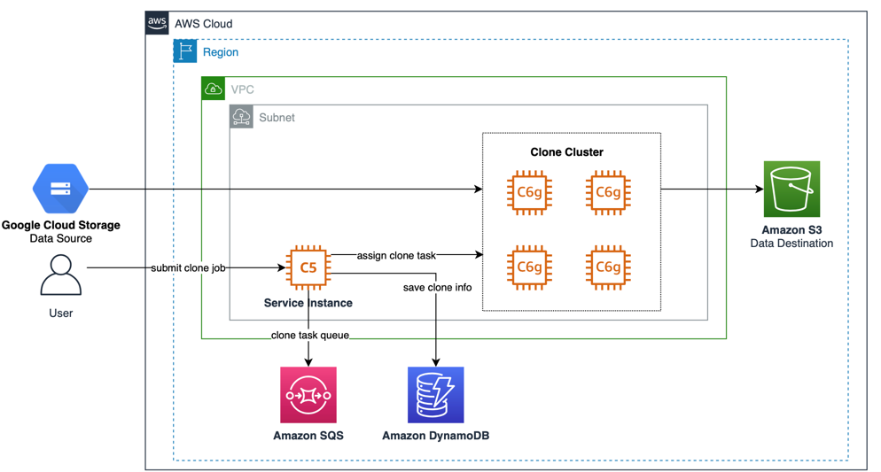

Cloud Storage To AWS S3 Tool
======================================

This tool is used to transfer data from Google GCS and other cloud providers (supported by Rclone) to AWS S3. It allows you to batch start and manage EC2 instances to transfer a large amount of data in parallel.
The architecture diagram based on Google GCS as the data source is as follows:

Component functions:

- Amazon SQS: Stores and sorts transfer tasks after they are issued.

- Amazon DynamoDB: Automatically creates three tables for storing transfer devices, task status, and configurations during system initialization.

Prerequisites
-------------
Building the project
--------------------

Navigate to the newly created folder:

Run the project with:

    mvn clean spring-boot:run

Navigate to:

    http://localhost:8080

Before starting, set the login credentials with environment variables (the application will not start without a password):

    export APP_USERNAME=<your-username>
    export APP_PASSWORD=<a-strong-password>

By default the application only listens on `127.0.0.1`. To reach it from another host, set `SERVER_ADDRESS` and restrict inbound access to trusted IPs with a security group.

Log in with the credentials you configured above.

Package the application
-----------------------

To package the project run:

    mvn clean package
We need to use the packaged jar file as the executable program.

The deployment document can be found in the deployment-guidance.pdf file in the repository. The document is in Chinese. If you need an English version, please feel free to contact us.

## Security notes

- All endpoints require authentication, and CSRF protection is enabled.
- The rclone command is fixed on the server side. Source, destination and log paths are validated and shell-quoted before they are sent to the transfer instances through SSM.
- Only the Spring Boot Actuator `health` endpoint is exposed, under `/actuator`.
- Grant `Rclone-EC2-Instance-Role` only what it needs: access to the source/destination and log buckets, plus `AmazonSSMManagedInstanceCore`.
- Do not bake long-lived GCS credentials into the transfer AMI; keep them in a secrets store such as AWS Secrets Manager.

## Security

See [CONTRIBUTING](CONTRIBUTING.md#security-issue-notifications) for more information.

## License

This library is licensed under the MIT-0 License. See the LICENSE file.

> ⚠️ **This repository is no longer maintained.**
> Please use [aws-samples/sample-data-transfer-tool](https://github.com/aws-samples/sample-data-transfer-tool) instead.
